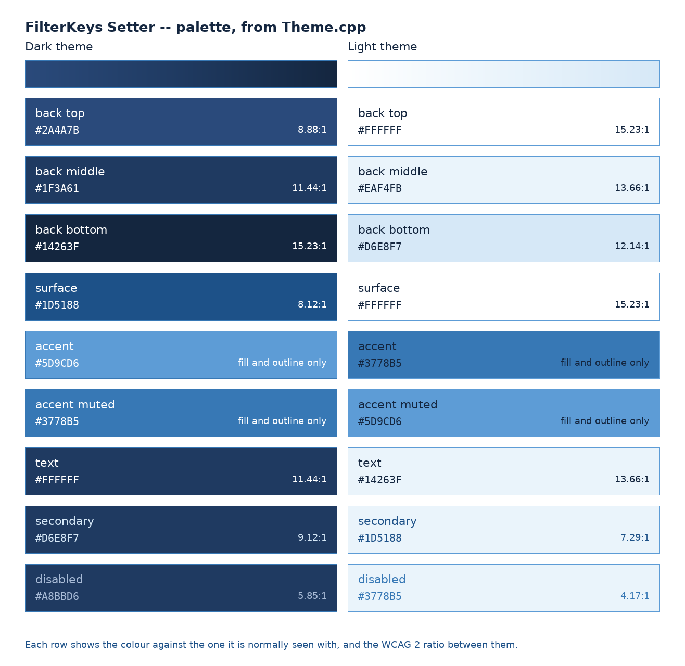

# Colour identity

The single list of colours this program is allowed to use, and what each
one is for. `tools/check-docs.py` reads this file: every colour
`Theme.cpp` defines has to appear here, and every colour any document
quotes has to be one `Theme.cpp` defines. The two rules close the circle,
so a colour cannot enter the program without being written down here
first.

The sheet above is generated by `tools/render-palette.py` out of the two
palettes in `Theme.cpp`, contrast figures included, so it shows what the
program uses rather than what this file would like it to use. Re-run it
after any colour change.

## The spectrum

One gradient, from luminous sky blue down to near-black navy. Nothing in
the identity is a flat block picked out of this list; the list is the set
of waypoints the gradients pass through.

| Token | Hex | Where it carries the identity |
| --- | --- | --- |
| Primary light | `#5D9CD6` | Highlights, glowing elements, active state. The accent of the dark theme, the outline tone of the light one. |
| Primary base | `#3778B5` | The standard brand colour: prominent elements, the accent of the light theme, the outline tone of the dark one. |
| Primary dark | `#1D5188` | Input surfaces in the dark theme, secondary text in the light one. Containers and deep text accents. |
| Secondary navy | `#2A4A7B` | Structural: the top of the dark background. |
| Slate navy | `#1F3A61` | The middle stop of the dark background. |
| Midnight navy | `#14263F` | The darkest tone: the foot of the dark background, and all primary text in the light theme. |
| Outline light | `#D6E8F7` | Soft borders, delicate dividers, edge illumination. The foot of the light background, and secondary text in the dark theme. |
| Canvas white | `#FFFFFF` | The primary canvas of the light theme, its input surfaces, and all primary text in the dark theme. |

## Derived tones

Two colours are in the code that are not waypoints. Both are written down
here because the checker insists, which is the point of the rule.

| Hex | Why it exists |
| --- | --- |
| `#EAF4FB` | The midpoint between `#FFFFFF` and `#D6E8F7`, used as the middle stop of the light background so that gradient has three stops like the dark one. Not a design decision, an interpolation. |
| `#A8BBD6` | Disabled text in the dark theme. No waypoint reaches 4.5:1 against the lightest band of that background: `#D6E8F7` at 7.1:1 is not weak enough to read as disabled, and `#5D9CD6` manages 3.0:1. This tone sits between them at 4.5:1. It is the one place the palette is extended rather than applied. |

## Rules

1. **Gradients, not blocks.** Backgrounds move between waypoints; both
   themes use the same three-stop, 128-band gradient. Large flat fills of
   a single waypoint are not part of the identity.
2. **Prominence is relative.** Against navy the brighter blue stands out,
   against white the darker one. The accent and the outline tone therefore
   swap between the themes rather than staying fixed, which is why the
   painters in `FilterKeysSetterDlg.cpp` name roles and never colours.
3. **No greys.** Not in text, not in borders, not in disabled states. The
   non-client sunken edge of the edit boxes was removed for this reason
   alone; see *The grey trench around the edit boxes* in
   [UI-UPGRADE.md](UI-UPGRADE.md).
4. **Contrast decides ties.** Where the identity and legibility disagree,
   legibility wins and the departure is written down. There are two:
   `#A8BBD6` above, and `#3778B5` as disabled text in the light theme at
   4.65:1 on white, below the 4.5:1 line on the lowest band of the
   background. Disabled text is exempt from the requirement; enabled text
   never is.
5. **High contrast is not ours.** When Windows high contrast is on, the
   palette steps aside completely and every control goes back to the
   system colours. `CTheme::IsBranded()` is the switch, and no painter may
   run without asking it.

## Contrast

Every enabled text pairing either theme can produce, as WCAG 2 ratios.
`tools/check-docs.py` recomputes each row from the two hex values, so
these numbers cannot drift away from the colours.

| Foreground | Background | Ratio |
| --- | --- | --- |
| `#FFFFFF` | `#2A4A7B` | 8.9:1 |
| `#FFFFFF` | `#1F3A61` | 11.4:1 |
| `#FFFFFF` | `#14263F` | 15.2:1 |
| `#FFFFFF` | `#1D5188` | 8.1:1 |
| `#FFFFFF` | `#3778B5` | 4.65:1 |
| `#D6E8F7` | `#2A4A7B` | 7.1:1 |
| `#D6E8F7` | `#1D5188` | 6.5:1 |
| `#14263F` | `#FFFFFF` | 15.2:1 |
| `#14263F` | `#EAF4FB` | 13.7:1 |
| `#14263F` | `#D6E8F7` | 12.1:1 |
| `#14263F` | `#5D9CD6` | 5.2:1 |
| `#1D5188` | `#FFFFFF` | 8.1:1 |

## Where it lives in the code

| Thing | File |
| --- | --- |
| The two palettes and the high contrast fallback | `Theme.cpp` |
| The gradient and the slice a child control sits on | `CTheme::PaintBackgroundSlice` |
| Buttons, group boxes, check boxes, radio buttons | the painters in `FilterKeysSetterDlg.cpp` |
| Trackbars | `CFilterKeysSetterDlg::OnCustomDrawSlider` |
| Edit boxes and labels | `CFilterKeysSetterDlg::OnCtlColor` |
| Tool tips | `CTheme::ApplyToToolTip` |
| The previews under `img/` | `tools/render-dialog.py`, which carries both palettes and has to match |
| The sheet at the top of this file | `tools/render-palette.py`, which reads them instead |
