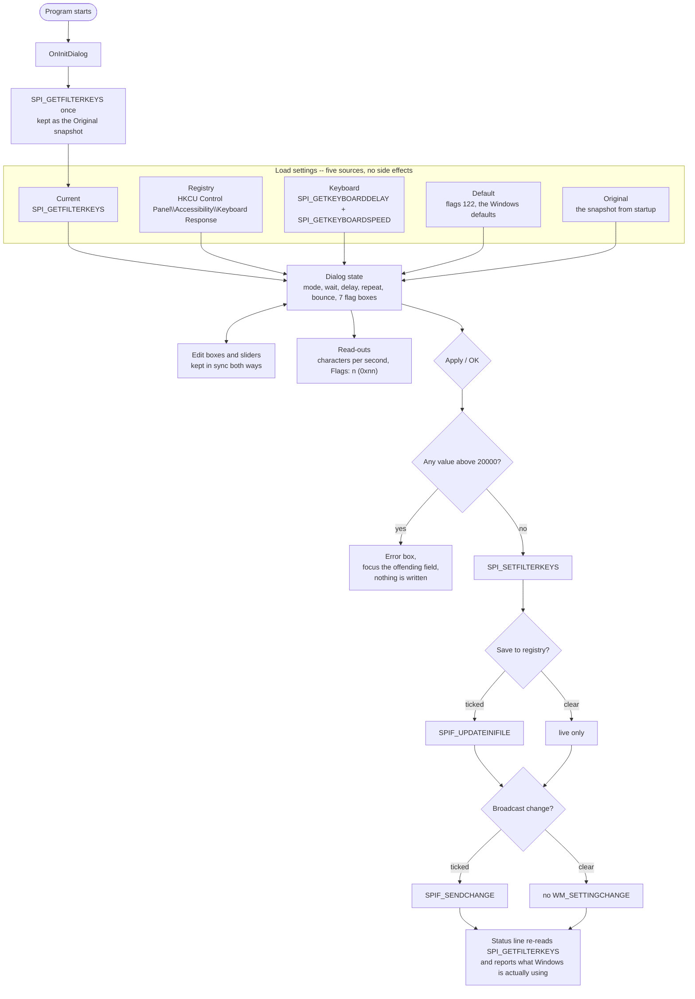
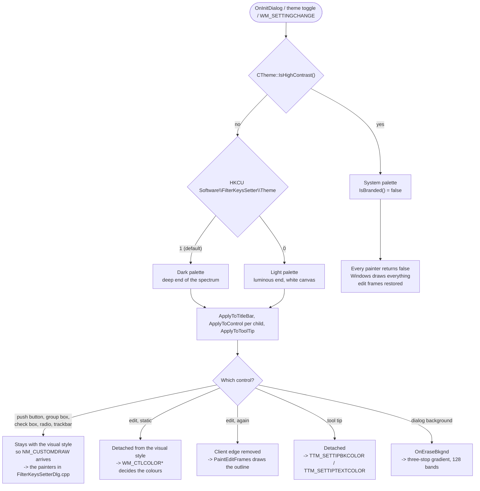

# How it flows

Three diagrams for the three questions people ask of this repository:
what the program does, who draws what, and how a change gets from an edit
to a release. They are Mermaid, so GitHub renders them in the browser and
they stay diffable as text.

The behaviour shown in the first diagram is the part that was deliberately
**not** changed in 1.11: the `SPI_*` calls, the registry reads and the five
presets work exactly as they did in 1.10.

## 1. What the program does

Everything the dialog knows sits in its member variables. The five *Load
settings* buttons fill them from five different sources, the fields and
sliders edit them, and *Apply* is the only path that leaves the process.

The status line is the honest one: the fields show what *would* be applied,
the line underneath shows what Windows has. They differ until *Apply* is
pressed, and that is on purpose.

## 2. Who draws what

Three states, not two. `IsDark()` answers which theme is active;
`IsBranded()` answers whether the palette applies at all, and it is false
exactly when Windows high contrast is on.

The rule behind the split: a control detached from the visual style sends
no `NM_CUSTOMDRAW`, and a control still attached to it ignores the brush
from `WM_CTLCOLOR*`. Each control has to be on exactly one of the two
paths, and `tools/check-message-map.py` fails the build if one ends up on
both or neither. The colours all come from [BRAND.md](BRAND.md).

## 3. From an edit to a release

```mermaid
flowchart LR
    edit([Edit a file]) --> all["tools/check-all.py"]

    subgraph checks["Eight checkers, under a second, no toolchain"]
        c1["check-dialog-layout.py"]
        c2["check-message-map.py"]
        c3["check-resources.py"]
        c4["check-error-handling.py"]
        c5["check-project.py"]
        c6["check-docs.py"]
        c7["check-theme.py"]
        c8["check-images.py"]
    end

    all --> checks
    checks --> self["selftest.py<br/>53 mutations, each has to be caught"]
    self --> verdict{"all 9 checks passed?"}
    verdict -- no --> edit
    verdict -- yes --> build["tools/build.cmd<br/>Win32 and x64, needs MSVC + MFC"]

    build --> manual["docs/TESTING.md<br/>the part no checker can do"]
    manual --> version["Version in six places<br/>see RELEASE.md"]
    version --> rel["tools/release.cmd v1.11<br/>or the Release workflow"]
    rel --> draft["Draft release with both binaries<br/>notes = the CHANGELOG entry"]
```

Two things this diagram is honest about. The build step has never run:
there is no MSVC in the environment these changes were written in, which
is why there are eight checkers in front of it. And the previews under
`img/` come from `tools/render-dialog.py`, not from a running program --
the first real screenshot is still owed.
