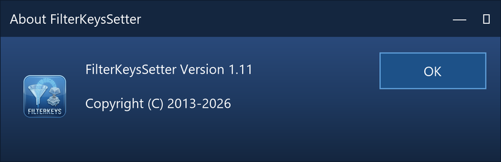
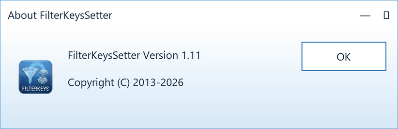

# UI upgrade — FilterKeys Setter 1.10 → 1.11

Reference for the dialog rework: what changed, how to verify it, and how to get
back if something turns out wrong.

## Scope

The application is **C++ / MFC**, not WinForms or WPF, so the upgrade is built
from `WM_CTLCOLOR*` handlers, `SetWindowTheme`, custom draw and GDI — there are
no styles, resource dictionaries, Mica or NuGet packages involved. No new
dependency was added; the only extra import library is `uxtheme.lib`, which
ships with the Windows SDK.

Deliberately **not** done: per-monitor DPI awareness, noted under
*Known trade-offs*.

## What changed

| Area | Before | After |
|---|---|---|
| Dialog font | `MS Shell Dlg` 8 pt (maps to Tahoma, a Windows XP look) | Segoe UI 9 pt |
| DPI | Not declared — bitmap-stretched and blurry above 100 % scaling | System DPI aware |
| Manifest | Present in `res/`, referenced by nothing, hard-coded `X86` | Merged into the binary; `supportedOS` for Windows 7–11, `longPathAware` |
| Colours | System default | Two themes from the brand spectrum: the deep half for dark, the luminous half on white for light |
| Repeat delay / rate | Numeric edit boxes only | Edit boxes plus synchronised sliders with a cyan thumb |
| Flags readout | `(122)` | `Flags: 122 (0x7A)` |
| Status | None | Live line showing what Windows is actually using |
| Help | None | Tooltips on all 28 controls including the three read-outs, flag checkboxes name their `FKF_*` constant |
| Accessible names | Missing — all labels sat at the end of the resource | Each label precedes its control; sliders carry their name in the window text |
| About box | Native light only | Follows the selected theme |
| High contrast | Ignored | Custom palette steps aside automatically |

## Colour palette

The full identity, including what each colour is *for* and the rules that
govern it, is in [BRAND.md](BRAND.md). What follows is how this dialog
applies it.

Both themes are cut from one spectrum -- `#5D9CD6`, `#3778B5`, `#1D5188`,
`#2A4A7B`, `#1F3A61`, `#14263F`, with `#D6E8F7` as the light outline tone.
Dark mode uses the deep end of it, light mode the luminous end on a white
canvas:

| Role | Dark | Light | High contrast |
|---|---|---|---|
| Background top | `#2A4A7B` | `#FFFFFF` | `COLOR_3DFACE` |
| Background middle | `#1F3A61` | `#EAF4FB` | `COLOR_3DFACE` |
| Background bottom | `#14263F` | `#D6E8F7` | `COLOR_3DFACE` |
| Surface (edit fields) | `#1D5188` | `#FFFFFF` | `COLOR_WINDOW` |
| Accent (slider thumb) | `#5D9CD6` | `#3778B5` | `COLOR_HIGHLIGHT` |
| Muted accent (outlines) | `#3778B5` | `#5D9CD6` | `COLOR_HIGHLIGHT` |
| Primary text | `#FFFFFF` | `#14263F` | `COLOR_WINDOWTEXT` |
| Secondary text | `#D6E8F7` | `#1D5188` | `COLOR_WINDOWTEXT` |
| Disabled text | `#A8BBD6` | `#3778B5` | `COLOR_GRAYTEXT` |

The light column is a gradient as well, white drifting down to `#D6E8F7`;
`#EAF4FB` is the midpoint between the two. The accent and its muted
partner swap places between the themes, which is the whole trick: against
navy the brighter blue is the one that stands out, against white it is the
darker one.

The background is a **three stop** gradient: `#2A4A7B` at the top, `#1F3A61`
halfway down, `#14263F` at the bottom. `CTheme::PaintBackgroundSlice` walks
its 128 bands in two halves, and `PaintBackgroundSlice` lets a child control
reproduce exactly the slice sitting behind it, so the stops line up across
control boundaries.

Every text colour against every surface it can land on, as WCAG 2 contrast
ratios. `tools/check-docs.py` recomputes this table from the hex values and
fails if a number drifts, so it can be trusted rather than believed:

| Foreground | Background | Ratio |
| --- | --- | --- |
| `#FFFFFF` | `#2A4A7B` | 8.9:1 |
| `#FFFFFF` | `#1F3A61` | 11.4:1 |
| `#FFFFFF` | `#14263F` | 15.2:1 |
| `#FFFFFF` | `#1D5188` | 8.1:1 |
| `#FFFFFF` | `#3778B5` | 4.65:1 |
| `#D6E8F7` | `#2A4A7B` | 7.1:1 |
| `#D6E8F7` | `#14263F` | 12.1:1 |
| `#A8BBD6` | `#2A4A7B` | 4.5:1 |
| `#A8BBD6` | `#14263F` | 7.8:1 |
| `#14263F` | `#FFFFFF` | 15.2:1 |
| `#14263F` | `#EAF4FB` | 13.7:1 |
| `#14263F` | `#D6E8F7` | 12.1:1 |
| `#14263F` | `#5D9CD6` | 5.2:1 |
| `#1D5188` | `#FFFFFF` | 8.1:1 |
| `#1D5188` | `#D6E8F7` | 6.5:1 |
| `#3778B5` | `#FFFFFF` | 4.65:1 |

The worst case is 4.5:1 and the requirement is 4.5:1, which is not a
coincidence: it is what fixed the disabled colour. The old `#8CA4C4` was
chosen against a much darker background and managed 6.2:1 there:

| Foreground | Background | Ratio |
| --- | --- | --- |
| `#8CA4C4` | `#0A2342` | 6.2:1 |
| `#8CA4C4` | `#2A4A7B` | 3.5:1 |

Against the new, lighter top band the same colour drops to 3.5:1 -- below
the requirement. `#A8BBD6` restores it.

`#5D9CD6` is used for fills and outlines only, never for text. `#3778B5` is
text in exactly one place: disabled captions in the light theme, where it
reaches 4.65:1 on white and 3.71:1 on the lowest band of the background.
That is the one pair in either theme under 4.5:1. Disabled text is exempt
from the requirement, and the alternative -- a disabled field that looks
enabled -- is the worse accessibility outcome. Every enabled pairing is
above the line.

## Files touched

```
Theme.h / Theme.cpp        new — palette, brushes, gradient, title bar, high contrast
FilterKeysSetterDlg.h/.cpp theming, sliders, tooltips, status line, About box
FilterKeysSetter.rc        Segoe UI, new layout (228 × 276 DLU), control order
resource.h                 IDC_DELAY_SLIDER, IDC_REPEAT_SLIDER, IDC_DARKTHEME,
                           IDC_STATUS; IDC_EDIT1 renamed to IDC_TEST_EDIT
FilterKeysSetter.vcxproj   Theme.* added, manifest wired up, DPI awareness,
                           phantom wizard headers removed
res/FilterKeysSetter.manifest  rewritten
framework.h                trimmed to afxwin.h + afxcmn.h
FilterKeysSetter.h/.cpp    wizard placeholders removed, real registry key
FilterKeysSetter.Setup/    version 1.0.11, new ProductCode/PackageCode,
                           RemovePreviousVersions enabled
```

## Behaviour that must not change

Verified untouched by this work:

* `SPI_GETFILTERKEYS` / `SPI_SETFILTERKEYS` calls and their `fWinIni` flags
* `SPIF_UPDATEINIFILE` and `SPIF_SENDCHANGE` driven by the two check boxes
* Reads from `HKEY_CURRENT_USER\Control Panel\Accessibility\Keyboard Response`
  (`DelayBeforeAcceptance`, `AutoRepeatDelay`, `AutoRepeatRate`, `BounceTime`, `Flags`)
* `FKF_*` flag composition in `GetFlagsVal()` / `SetFlags()`
* The Current / Registry / Keyboard / Default / Original presets
* The 20000 ms validation limits

The theme preference is stored in a **separate** key,
`HKEY_CURRENT_USER\Software\FilterKeysSetter\Theme` (`REG_DWORD`, 0 = light,
1 = dark), so it can never collide with the accessibility settings.

### Which theme a first run opens in

`CTheme::LoadPreference()` asks three questions in order, and stops at the
first answer:

1. **This program's own value.** Present only once the *Dark theme* box has
   been ticked or cleared. An explicit choice is not something a system
   setting should overrule later, so from then on Windows is not consulted.
2. **What the user chose for Windows.** `AppsUseLightTheme` under
   `HKCU\Software\Microsoft\Windows\CurrentVersion\Themes\Personalize`,
   which is what *Settings → Personalisation → Colours → Choose your default
   app mode* writes. `0` means dark.
3. **Dark**, which is the theme the application icon is built from, and the
   answer on anything older than Windows 10 1809, where that value does not
   exist.

Because the whole chain is re-read in `RefreshThemeFromSystem()`, a machine
with no stored preference also *follows* Windows: switching the app mode
sends `WM_SETTINGCHANGE` with `ImmersiveColorSet`, and the dialog changes
over with the rest of the desktop. One tick of the check box ends that and
pins the choice.

## Migration checklist

1. Pull the branch and open `FilterKeysSetter.sln` in Visual Studio 2022.
2. Confirm the *Desktop development with C++* workload includes
   **MFC for latest v143 build tools** — the build fails without it.
3. Build `Release|x64` and `Release|Win32`.
4. If `TBS_NOTICKS` fails to resolve, check that `#include <commctrl.h>` is
   still present near the top of `FilterKeysSetter.rc`; the Visual Studio
   resource editor drops it if it rewrites the file.
5. Open the dialog editor once and eyeball `IDD_FILTERKEYSSETTER_DIALOG`. The
   tightest control is the multi-line radio button at 108 × 24 units.
6. Delete any stale `Debug/`, `Release/`, `x64/` output; the manifest is now
   embedded and old binaries will not pick it up.

## Keyboard cues on the custom-drawn buttons

Adding the Alt accelerators broke something the owner-draw commit could not
have anticipated: `DrawText` underlines the character after an `&`
unconditionally, while Windows itself hides those underlines until the user
presses Alt or starts navigating with the keyboard. The eight custom-drawn
push buttons would therefore have been the only controls in the dialog
showing `Appl`<u>`y`</u> underlined from the moment the window opened.

Windows publishes that preference per window as the *UI state*. The painter
now asks for it and suppresses the underline accordingly:

```cpp
UINT uFormat = DT_CENTER | DT_VCENTER | DT_SINGLELINE;
const LRESULT uiState = ::SendMessage(pcd->hdr.hwndFrom, WM_QUERYUISTATE, 0, 0);
if ((uiState & UISF_HIDEACCEL) != 0) {
    uFormat |= DT_HIDEPREFIX;
}
```

No extra message handler is needed: when the state changes the dialog
manager sends `WM_UPDATEUISTATE` down the window tree and the button
invalidates itself, which brings `NM_CUSTOMDRAW` round again with the new
answer. Users who have *Underline access keys* switched on permanently in
*Ease of Access* see the underlines all the time, exactly as elsewhere.

## Layout check

`tools/check-dialog-layout.py` parses `FilterKeysSetter.rc` and reports controls
that leave the dialog, overlap each other, poke out of their group box, or carry
a caption too long for their width at Segoe UI 9 pt. Run it after any change to
the resource:

```cmd
python tools\check-dialog-layout.py
```

It found three undersized check boxes and the *Keyboard* preset button after the
font change; all four have been widened.

## Releases that need no Windows machine

The release binaries were the one artefact that could not be produced from
this environment: MFC needs MSVC. `docs/workflows/release.yml` moves that
work to GitHub -- static checks, then `Release` builds of `Win32` and `x64`
on `windows-2022`, named from the version in the resource script rather
than from the tag, attached to the release with `gh release upload
--clobber` so a re-run replaces the assets instead of failing.

It lives under `docs/` rather than `.github/workflows/` because the token
used here has no `workflow` scope and the push is rejected outright. Keeping
the file in the repository anyway means it is reviewed and diffed like the
rest; `check-project.py` scans it as a build script, so pointing it at the
solution instead of the project is caught (self test case 34).

## Toolchain: Visual Studio 2022 and 2026

Visual Studio 2026 (18.x) ships the **v145** platform toolset and no longer
carries v143. A project with a hard-coded `<PlatformToolset>v143</PlatformToolset>`
fails there before a single file is compiled:

```
error MSB8020: The build tools for v143 (Platform Toolset = 'v143')
cannot be found.
```

Rather than move the project to v145 and lock out VS 2022, the toolset is now
resolved from the Visual Studio that is running the build:

```xml
<PlatformToolset Condition="'$(PlatformToolset)' == ''">$(DefaultPlatformToolset)</PlatformToolset>
<PlatformToolset Condition="'$(PlatformToolset)' == ''">v143</PlatformToolset>
```

`$(DefaultPlatformToolset)` is set by `Microsoft.Cpp.Default.props`, which is
imported above the configuration property groups, so it is already available:
v143 under VS 2022, v145 under VS 2026. The second line is a fallback for
exotic environments where the property is empty. Both stay out of the way of
`/p:PlatformToolset=...` on the command line.

Two things to know when building with VS 2026:

* **Install the MFC component for v145** (*C++ MFC for latest v145 build tools*).
  It is not part of the *Desktop development with C++* workload; without it the
  build stops at `afxwin.h`.
* **Do not accept *Retarget solution*.** It writes a fixed `v145` into the
  `.vcxproj` and undoes the conditional above. Choose *Install missing platform
  toolset* instead, or simply dismiss the dialog — the project builds as is.

`ConformanceMode` is now pinned to `false` in a global `ItemDefinitionGroup`.
It was already off by omission, but the v145 toolset is a good deal stricter
and a future template default flipping to `/permissive-` would bury real
diagnostics under conformance errors in this 2013-era MFC code. The decision is
recorded in the project file instead of depending on a default.

The setup project needs *Microsoft Visual Studio Installer Projects* **3.0.0 or
newer** under VS 2026; older builds of the extension crash on it.

`tools/build.cmd` wraps all of this: it resolves the Visual Studio installation
with `vswhere` (so it works regardless of which version is present), reports
whether the MFC component is installed, and builds `FilterKeysSetter.vcxproj`
rather than the solution -- the `.vdproj` and its extension have no bearing on
whether the application compiles. Errors and warnings from every platform are
collected into one list at the end.

## Compacting the dialog

After the font change the dialog had grown to 228 × 322 DLU (399 × 604 px at
100 %), with more air than content in places. It is now **228 × 276 DLU**
(399 × 518 px), roughly 15 % shorter, without dropping a single control:

| Change | DLU saved |
| --- | --- |
| Row pitch in the *Settings* group 18 → 16, first row moved up | 14 |
| Slider height 14 → 12, gap to the edit above tightened | 6 |
| *Load settings* and *Test area* group boxes 30 → 28 high | 4 |
| *Appearance* group box dropped; *Dark theme* moved beside *OK* | 22 |

The *Appearance* frame carried a single check box, and its caption said
nothing that *Dark theme* did not already say. Next to the *OK* button the
check box is just as easy to find, and the right-hand column now ends level
with the left one.

Nothing moved in z-order, so the tab order and `DDX_Radio` are untouched; only
coordinates changed. Verified with `tools/check-dialog-layout.py` (clean) and
`tools/render-dialog.py`.

## Message map check

`tools/check-message-map.py` compares the three places an MFC handler has to
appear: the entry in `BEGIN_MESSAGE_MAP`, the `afx_msg` declaration in the
class, and the definition in the `.cpp`. It also checks every control ID used
in a map or in `DDX_*` against `resource.h`, flags duplicate entries, and
reports `afx_msg` members that no map references any more.

```cmd
python tools\check-message-map.py
```

Why a tool for this: the compiler does catch these mistakes, but it reports
them from inside the macro expansion, and the `.cpp` grew eight new
`ON_NOTIFY` entries for the push buttons alone. Verified by injecting three
faults -- a typo in a handler name, a typo in a control ID, and an
`ON_WM_TIMER()` with no handler behind it -- all three were reported.

It also follows the control IDs out of the code and into the resource
script: every ID used by `DDX_*`, by `GetDlgItem` or by the tool tip table
has to belong to a dialog in `FilterKeysSetter.rc`, not merely exist in
`resource.h`. And it knows one MFC trap: a tool tip on a static only ever
appears if that static carries `SS_NOTIFY`, because without it the control
returns `HTTRANSPARENT` and never sees the mouse.

Current state: clean, with one note. `ON_COMMAND(ID_HELP, CWinApp::OnHelp)`
in `FilterKeysSetter.cpp` points at a base class member, which the tool
reports and skips rather than guessing at MFC's own class hierarchy.

## Dialog preview

`tools/render-dialog.py` draws the main dialog from the resource script and the
theme palette:

```cmd
python tools\render-dialog.py            :: both dialogs, both themes
python tools\render-dialog.py --theme dark
python tools\render-dialog.py --dialog about
```

It shares its parser with the layout checker, so the geometry in
`docs/img/dialog-dark.png` and `docs/img/dialog-light.png` is the geometry in
`FilterKeysSetter.rc`: if a control is moved, the picture moves with it on the
next run. What it cannot show is the dialog font (Segoe UI is not available
outside Windows) and the native chrome of the common controls. It is a layout
preview and a stand-in for the README, not a substitute for a screenshot.

The About box is drawn the same way, which is the only picture there is of
the claim in the table at the top of this file that it follows the theme:





Its icon is the real one -- `res/logo.png`, scaled into the rectangle the
`ICON` statement gives it -- so the preview also shows whether the artwork
survives at 20 by 20 dialog units. The *OK* button goes through
`PaintThemedPushButton` like every other button in the program: the About
box has its own two-line `NM_CUSTOMDRAW` handler and shares the painter,
which is why it cannot drift away from the main window.

## Testing checklist

**Functional**

- [ ] Each of the five presets loads plausible values
- [ ] Switching the two radio buttons enables/disables the right fields *and* sliders
- [ ] Apply writes the settings; the status line updates to match
- [ ] OK applies and closes; Cancel discards
- [ ] A value above 20000 is still rejected with the existing message box
- [ ] *Save to registry* survives a sign-out; without it the change is session-only
- [ ] `Control Panel\Accessibility\Keyboard Response` holds the expected values afterwards

**Sliders**

- [ ] Dragging the delay slider updates the edit box and vice versa
- [ ] Dragging the rate slider also updates the characters-per-second readout
- [ ] Typing a value beyond the slider range clamps the thumb but keeps the typed value
- [ ] No flicker or infinite update loop between slider and edit box

**Visual**

- [ ] Gradient is smooth, no banding, no seam behind the sliders
- [ ] Slider thumb is cyan when enabled, grey when disabled
- [ ] No black-on-dark or white-on-white text anywhere
- [ ] Title bar is dark in the dark theme, light in the light theme
- [ ] About box matches the main window
- [ ] Theme switch takes effect immediately and survives a restart

**DPI and themes**

- [ ] 100 %, 125 %, 150 %, 200 % scaling — text crisp, nothing clipped
- [ ] Light theme looks like a native Windows dialog
- [ ] Turning Windows high contrast on while running drops the custom palette
- [ ] The *Dark theme* check box is disabled while high contrast is active

**Accessibility**

- [ ] Tab reaches every control; focus is always visible
- [ ] Narrator announces a meaningful name for each edit box and both sliders
- [ ] Narrator reports the status line, the characters per second and the
      flags value when they change, without the focus moving
- [ ] Sliders respond to arrow keys, Page Up/Down, Home/End
- [ ] Tooltips appear on hover and stay long enough to read
- [ ] Accesskeys and Esc/Enter still behave

## Three labels nobody was told about

The dialog has three read-outs that are not controls anybody can reach:
the status line, *(x.x per second)* next to the repeat rate, and the flags
value. They are statics, so they are not in the tab order, so a screen
reader walks past them -- and the one thing they exist for is to change
while the user is doing something else.

`CFilterKeysSetterDlg::SetReadout()` is now the only way their text is
written. It does two things beyond `SetWindowText`:

```cpp
if (strCurrent == strText) {
	return;                       // nothing changed, say nothing, paint nothing
}

label.SetWindowText(strText);
::NotifyWinEvent(EVENT_OBJECT_NAMECHANGE, label.GetSafeHwnd(),
                 OBJID_CLIENT, CHILDID_SELF);
```

`EVENT_OBJECT_NAMECHANGE` is the MSAA notification for *this object is
still here, its name is different now*, and a static's name is its text.
It costs one call and needs no UI Automation provider, no live-region
property and no extra dependency.

The comparison in front of it is not a stray optimisation. The
characters-per-second label is rewritten on every keystroke in *Repeat
rate*, usually with the identical string; announcing an unchanged value
is worse than saying nothing, and the repaint that came with it was
wasted too.

## Push buttons in the dark theme

The eight push buttons were the last native-grey island in the dark dialog,
and the new, lighter palette made them stand out more than before. They are
now drawn by the dialog, through `NM_CUSTOMDRAW` rather than `BS_OWNERDRAW`:

* no resource change, so the buttons stay ordinary push buttons for the
  dialog manager, for `DDX` and for screen readers,
* a single `CDDS_PREPAINT` branch per button; everything else falls through
  to the default drawing.

| State | Face | Notes |
| --- | --- | --- |
| Normal | `#1D5188` | white text, 8.1:1 |
| Hover | `#3778B5` | white text, 4.65:1 |
| Pressed | `#14263F` | plus the usual one pixel text nudge |
| Disabled | `#1F3A61` | `#A8BBD6` text |

The default button (*OK*) carries a two pixel `#5D9CD6` border, a focused
button the same border plus the system focus rectangle, so keyboard focus
stays visible without relying on colour alone.

This is why `CTheme::ApplyToControl` leaves push buttons attached to the
visual style: an unthemed button falls back to classic drawing and never
sends `NM_CUSTOMDRAW`.

The painter itself is a file-local function, `PaintThemedPushButton`, not a
member of either dialog. Both the main window and the About box call it from
their own two-line `NM_CUSTOMDRAW` handler, so the *OK* button in the About
box cannot drift away from the eight buttons in the main window.

## Installer audit

`FilterKeysSetter.Setup.vdproj` carries a list of "detected dependencies" that
Visual Studio collected years ago. Two of them are worth knowing about.

**The seven `api-ms-win-crt-*.dll` files are now excluded.** They are APISet
forwarders of the Universal CRT, and the installer shipped seven of them
without `ucrtbase.dll`, which they forward to. Microsoft's guidance is
explicit: the UCRT is an operating system component, app-local deployment is
supported but discouraged, and **on Windows 10 and 11 the copy in the system
directory is always used, even when the application ships a newer one**. So
those seven files were dead weight on every supported Windows version, and on
an older one the incomplete set could not have worked either. They are set to
`Exclude = TRUE` rather than deleted, so the entries can be switched back on
in the IDE if someone ever needs a Windows 7 package.

`VCRUNTIME140.dll`, `VCRUNTIME140_1.dll` and `mfc140u.dll` stay in the
package. Those are genuinely redistributable, they make the MSI work without
a separately installed VC++ redistributable, and their names do not change
under the v145 toolset: MSVC 14.50 keeps binary compatibility with everything
back to 2015 and still ships as the **v14** runtime family.

**The packaged executable is hard-coded to `..\x64\Release\FilterKeysSetter.exe`.**
It is a plain file reference, not *Primary output from FilterKeysSetter
(Active)*. Consequences: building the setup in `Debug` or for `Win32` still
packages the x64 release binary, and building it without an x64 release build
present fails. This has not been changed here, because replacing a file
reference with a project output means hand-editing GUID-keyed blocks in a
format no tool validates. In the IDE it is three clicks: remove the file from
*Application Folder*, *Add → Project Output → Primary output*, then re-point
the shortcut at it.

## Keyboard accelerators

Until now not a single control in `IDD_FILTERKEYSSETTER_DIALOG` carried an `&`.
Tab and the arrow keys worked, but nothing could be reached directly, and a
screen-reader user had no way to jump to a field. Every interactive control
now has an Alt accelerator:

| Alt | Control | Alt | Control |
| --- | --- | --- | --- |
| Q | Ignore **q**uick keystrokes (radio) | V | Sa**v**e to registry |
| F | repeated **f**aster than (radio) | B | **B**roadcast change |
| I | **I**gnore under | T | Dark **t**heme |
| D | Repeat **d**elay | E | Curr**e**nt |
| M | Bounce ti**m**e | G | Re**g**istry |
| R | Repeat **r**ate | K | **K**eyboard |
| O | **O**n | L | Defau**l**t |
| A | **A**vailable | N | Origi**n**al |
| U | **U**se shortcut | P | A**p**ply |
| C | **C**onfirm activation | | |
| S | Activation **s**ound | | |
| H | S**h**ow status | | |
| Y | Ke**y** click | | |

Notes on the choices:

- Twenty-two controls compete for twenty-six letters, so a few accelerators
  land mid-word (`Curr&ent`, `Defau&lt`, `Origi&nal`). That is normal in dense
  dialogs; thirteen of them still sit on a word initial.
- Group boxes deliberately get none. Their accelerator would move the focus to
  the next control in z-order, which is a surprise rather than a shortcut.
- OK and Cancel get none either, by convention: Enter and Esc already reach
  them, and `&O`/`&C` would collide with *On* and *Confirm activation*.
- The labels are `RTEXT` statics placed immediately before their edit box in
  z-order, which is exactly what the dialog manager needs — a static
  accelerator hands the focus to the *next* control, so Alt+D lands in the
  delay field.
- `tools/check-docs.py` compares this very table against the `&` markers in
  the resource script, in both directions: a letter added to a caption but
  not to the table, and a row left behind after a caption changed, are both
  reported. The table is the kind of thing that rots within two commits.
- `tools/check-dialog-layout.py` now fails when two controls in the same
  dialog claim the same letter, and ignores `&` when it estimates caption
  widths. `tools/render-dialog.py` strips the `&` and underlines the marked
  character, so the preview images match what Windows draws with Alt held.

Three further rules keep the accelerators honest, because all of them depend
on z-order rather than on anything visible in the dialog editor:

| Rule | Why it exists |
| --- | --- |
| A label accelerator must be followed by a focusable control | `RTEXT` cannot take the focus, so the accelerator is handed to the *next* control in z-order. Move a label and the shortcut silently lands somewhere else. |
| …and that control must share the label's row | Catches exactly that case: in a mutation test, an `&` on the `ms` suffix of the delay row was reported as focusing `IDC_DELAY_SLIDER` one row below. |
| A focusable `CONTROL` statement needs an explicit `WS_TABSTOP` | `EDITTEXT`, `PUSHBUTTON` and friends get one implicitly; `CONTROL` does not. A check box written as `CONTROL` without it drops out of the tab chain while still looking perfectly normal. The sole exception is a radio button that follows another one — those are one tab stop, and the first of them is checked for `WS_GROUP` instead. |

All three were verified by mutating the `.rc` and confirming the checker
fails, then restoring it.

## Resource and version check

`tools/check-resources.py` covers the bookkeeping that no compiler complains
about. Run it with `python tools/check-resources.py`; it prints
`38 symbol(s), 0 problem(s)` and exits 0 when the repository is healthy.

| It fails when | Why that matters |
| --- | --- |
| Two symbols of the same family share a value | `IDC_DARKTHEME` and `IDC_STATUS` both on 1027 means `DDX` writes into the wrong control and `GetDlgItem` returns the wrong window. Nothing warns you. |
| An `_APS_NEXT_*` counter has fallen behind | The dialog editor hands out the next ID from that counter, so the next control added in the IDE silently duplicates an existing one. |
| An `IDC_`/`IDD_` symbol is used but not defined | The `.rc` still compiles if some other header happens to define it. |
| `FILEVERSION`, `PRODUCTVERSION` and the two `VALUE` strings disagree | Windows shows one number in the file properties and another in the installer. |
| The about box, the installer `ProductVersion` or the newest README entry do not match `VERSIONINFO` | The version lives in five places; bumping four of them is the normal outcome. |

Symbols that are defined but never used are reported as a note, not a
failure. Every rule was verified by mutating a throw-away copy of the tree
and confirming the exit code turns to 1.

## The icon container

`res/FilterKeysSetter.ico` is built by `tools/make-icon.py` from the 256 px
master in `res/logo.png`:

```
pip install Pillow
python tools\make-icon.py
```

It writes ten frames -- 16, 20, 24, 32, 40, 48, 64, 96, 128 and 256 px.
The unusual ones earn their place: 20 and 40 px are what the shell asks for
at 125 % and 150 % DPI, and without them Windows rescales the 16 and 32 px
frames into something visibly soft. Everything up to 96 px is stored as an
uncompressed 32-bit BMP with an AND mask, the form every Windows version
understands; 128 and 256 px are PNG-compressed, which is what PNG frames in
icons were introduced for -- as BMPs those two would add about 170 KB.
Pillow's own ICO writer PNG-compresses every frame, so the container is
assembled by hand in that script.

`tools/check-resources.py` reads the container back without Pillow (an .ico
directory is a six-byte header plus sixteen bytes per frame) and fails when
the file named in the `.rc` is missing, when it does not parse, or when the
16, 32, 48 or 256 px frame is absent. Frames below 32 bpp and an
uncompressed 256 px frame are reported as notes.

## Checking that Win32 results are not dropped

Three of the bugs above were the same bug: a Win32 read whose result nobody
looked at, followed by code using a buffer the call had never filled. The
buffer is zeroed, and zero is a plausible timing, so the dialog showed an
invention instead of a system setting. That pattern is now a rule rather
than a memory.

`tools/check-error-handling.py` flags calls to `SystemParametersInfo` and the
`Reg*` family that stand alone as a statement with nothing done to their
result. Ignoring a result is occasionally right -- failing to store the theme
preference only means the next start opens in the default theme -- so an
explicit `(void)` cast marks that as a decision:

```cpp
// Deliberately unchecked: if the preference cannot be stored the next start
// simply opens in the default theme.
(void)::RegSetValueEx(hKey, kThemeValue, 0, REG_DWORD, ...);
```

That is the only such call in the project; everything else is checked. The
MFC wrappers that share a name with a Win32 function (`CWnd::GetClientRect`
and friends) return `void` and are deliberately not in the list -- a bare
call is the only way to write them.

Expected output: `3 file(s), 0 problem(s)`. The self test covers both
directions: dropping a real check is caught, and so is removing the `(void)`
marker.

## What the first real screenshot showed

Everything above was written without a compiler. The first screenshot of
the program actually running showed two faults that no static check could
have found, because both are about what the visual style engine does with
a control rather than about what the code says.

**White edit boxes in a dark dialog.** `OnCtlColor` returns the surface
brush for `CTLCOLOR_EDIT`, which is correct and was not enough: a *themed*
edit control paints its own background from the visual style and ignores
that brush. The boxes stayed white with dark text. `CTheme::ApplyToControl`
now detaches `Edit` from the style the same way it already detached check
boxes and statics, after which the brush is honoured.

**A line through two group box captions.** *Load settings* and *Test area*
were struck through by their own frame. A classic group box draws its
frame as a plain rectangle and relies on the caption being painted with an
opaque background -- but the theme hands every static a hollow brush and
`TRANSPARENT` background mode, so the line stayed visible behind the text.

The fix is the same approach the push buttons already use: let the control
keep the visual style so that it still sends `NM_CUSTOMDRAW`, and draw it
here. `PaintThemedGroupBox` reproduces the gradient slice behind the box,
then draws the frame as four separate lines so the top one can stop before
the caption and resume after it, and finally the caption in the theme's
text colour. The five group boxes needed real control IDs for that --
`IDC_GRP_SETTINGS` and friends, replacing `IDC_STATIC`, which is `-1` for
all of them and cannot be addressed by `ON_NOTIFY`.

**White check boxes and radio buttons.** Not a fault exactly, but the same
cause and clearly visible in the screenshot: detached from the style, a
check box falls back to the classic white square with a black tick, and a
radio button to a white circle. Against `#1F3A61` they are the brightest
thing on the dialog. They now keep the style and are drawn by
`PaintThemedCheckBox`: surface-coloured indicator, accent border, a tick
drawn as two strokes, a filled dot for radios, the accent border on hover
and focus, and the caption in the theme's text colour with the same
`UISF_HIDEACCEL` rule the push buttons use. Captions that wrap, such as
the two radio buttons, are measured with `DT_CALCRECT` first and only
centred vertically when they fit on one line.

That makes four of the five control kinds in this dialog custom drawn in
dark mode -- push buttons, trackbars, group boxes, check boxes and radio
buttons -- with statics and edits handled through `WM_CTLCOLOR*`.
`tools/render-dialog.py` already drew the intended look; the gap was in
the program, and the preview images are unchanged by these fixes, which is
the point.

Worth noting what this says about the checkers: they verified that the
handler existed, was declared, was mapped, had the right signature and
addressed a control that exists. All of that was true while the dialog
still looked wrong.

## Letting the light theme join the brand

Until now the light theme was deliberately plain: `GetSysColor` for
everything, the native look, the brand confined to dark mode. The brand
guidelines put white at the centre of the identity rather than outside it
-- a pure white canvas, luminous blues for prominence, midnight navy for
type -- so the light theme is now drawn from the same spectrum as the dark
one and the two are mirror images:

* The background drifts from `#FFFFFF` at the top to `#D6E8F7` at the
  foot, through the same three-stop, 128-band gradient the dark theme
  uses. No harsh edge anywhere, which is guideline one.
* Surfaces stay pure white, text is midnight navy `#14263F`, computed
  read-outs are the deep blue `#1D5188`.
* Accent and muted accent swap: `#3778B5` carries prominence against
  white, `#5D9CD6` does the outlines. In dark mode it is the other way
  round. That swap is why one set of painters can serve both themes
  without a single conditional inside them -- they only ever name roles,
  never colours.

**What high contrast made necessary.** Every painter used to ask
`IsDark()`, which doubled as "is the brand palette in charge", because
high contrast was implemented by forcing light mode. With light mode
branded that shortcut becomes a bug: high contrast would get the brand
colours instead of the user's own. `CTheme` therefore separates the two
questions. `IsDark()` is still the theme, and the new `IsBranded()` is
false only under high contrast, where the palette falls back to the system
colours and every painter returns false so Windows draws the control. The
painters all ask `IsBranded()` now; the *Dark theme* check box still asks
`IsDark()`, because that is what it shows.

`check-message-map.py` got the rule that keeps this honest: every
`PaintThemed*` function has to guard on `IsBranded()`. Asking `IsDark()`
is reported by name, and so is a painter with no guard at all --

```
PaintThemedCheckBox asks IsDark(); a painter has to ask IsBranded(), or it
repaints the high contrast scheme in brand colours
```

-- because that mistake produces nothing visible until someone with high
contrast turned on opens the dialog.

Nothing in the dark theme moved. `docs/img/dialog-light.png` was
regenerated and is no longer a grey box: `tools/render-dialog.py` carries
both palettes, and the preview is worthless the moment it shows colours
the program does not use. Three places in the renderer were flattering the
implementation and were corrected at the same time -- the indicator face
of a ticked check box is the surface colour, not the accent, the tick is
drawn in the text colour, and a radio dot likewise.

## The checker for the one trap with no warning

`tools/check-theme.py` is the seventh checker, and it exists for a single
C++ behaviour: a `ThemePalette` is filled by an aggregate initialiser, and
an aggregate initialiser with too few entries is **legal**. Add a field to
the struct, extend one of the two palettes and forget the other, and the
missing colour is value-initialised -- zero, which as a `COLORREF` is
black. No warning at any level, and black is plausible enough in a dark
theme to survive review.

It counts the entries against the fields and says so:

```
Theme.cpp:15: kDarkPalette sets 9 of the 10 fields in ThemePalette; the
rest are silently zero, which is black
```

Three more rules come with it, all of them things the compiler is happy
with:

* **`RGB()` only in `Theme.cpp`.** A colour hard-coded in a painter
  belongs to no palette, so no theme switch reaches it.
* **`GetSysColor` only in `MakeSystemPalette` and `ApplyToToolTip`.**
  Those two are the high contrast fallback; anywhere else a Windows grey
  walks back into a branded dialog.
* **No grey stock brushes.** This caught a real one: `Rebuild()` fell back
  to `DKGRAY_BRUSH` and `GRAY_BRUSH` when `CreateSolidBrush` fails. It
  now falls back to black or white depending on the theme -- still stock
  objects, because allocating a brush is what just failed, but no longer
  grey.
* Both palettes must list the same roles in the same order, which is also
  what lets `tools/render-palette.py` label the sheet.

## A colour sheet the compiler cannot ignore

Two colours in the code were not part of the identity at all: the dark
theme's secondary text was `#E0E0E0`, a neutral grey, and nothing stopped
the next one from being added. Documentation that lists a palette is a
promise; nothing had been checking it.

[BRAND.md](BRAND.md) is now that list, and `check-docs.py` closes the
circle in both directions:

* a colour quoted in any document must be defined in `Theme.cpp` -- the
  rule that already existed;
* a colour defined in `Theme.cpp` must be listed in `BRAND.md`.

Together they mean a colour cannot enter the program without being
written down, and cannot be written down without being used. The self
test adds a grey to `Theme.cpp` and insists the sheet notices.

`tools/render-palette.py` draws the sheet at the top of that file out of
the same two initialisers, contrast figures and all, so the picture of the
palette is generated rather than maintained. A palette sheet that is drawn
by hand is just a third place to forget.

`#E0E0E0` went in the same round. It is replaced by the brand's outline
tone `#D6E8F7`, which is not a compromise: 7.1:1 against the lightest
band of the dark background where the grey managed 6.7:1. The two
remaining non-waypoints are written down as extensions, with the reason
each exists -- `#EAF4FB` is an interpolation, `#A8BBD6` is the disabled
tone that no waypoint could supply at 4.5:1.

## The grey trench around the edit boxes

One frame in the dialog belonged to neither painter nor brush: the sunken
client edge of the five edit controls. It is **non-client**, drawn by
`DefWindowProc` in `COLOR_3DSHADOW` and `COLOR_3DHIGHLIGHT`, so no
`WM_CTLCOLOREDIT` brush and no custom draw can reach it. In the dark
theme that is a grey trench around a navy field; in the new light theme
it is the one grey left on a white dialog.

`CTheme::SetEditFrame` removes `WS_EX_CLIENTEDGE` and `WS_BORDER` while a
brand theme is active -- the change only takes effect after
`SWP_FRAMECHANGED`, which is the part that is easy to miss -- and
`EM_SETMARGINS` gives back the two pixels of breathing room the edge used
to provide. `CFilterKeysSetterDlg::PaintEditFrames` then draws a one pixel
outline in the muted accent into the gap, straight after the background
gradient in `OnEraseBkgnd`.

Taking the frame away makes the window's client area two pixels bigger in
each direction, and that would have moved the text: a single line edit
draws against the top of its client rectangle, so the field would have
kept its outline but dropped its baseline. `SetEditFrame` therefore
measures the client rectangle first, works out with `AdjustWindowRectEx`
which window rectangle holds that same client rectangle under the new
styles, and resizes the control to it. The client area comes out
unchanged, the control shrinks into the space the edge occupied, and the
outline is drawn where the edge used to be. Nothing in the `.rc` moves, so
`check-dialog-layout.py` still measures the geometry that was designed.

That outline is deliberately **not** focus-coloured. The parent background
is not repainted when focus moves from one field to the next, so a focus
colour drawn here would go stale on the field being left. The caret and
the selection show focus, exactly as they do in every other edit box in
Windows.

The same round made light mode detach its edits and statics from the
visual style, which until now only dark mode did. A themed edit paints its
own disabled background in the system grey, and grey is the one colour the
brand palette has no place for.

## The states a hand-drawn control has to remember

A painter replaces the style engine completely, so every state the engine
knew about has to be written out. `PaintThemedCheckBox` started with
three -- resting, hot, focused -- and was missing two:

* **Pressed.** Holding the mouse button on a check box gave no feedback at
  all. `CDIS_SELECTED` now darkens the indicator to the bottom of the
  background gradient, which together with the lighter hot state gives the
  same three steps the push buttons already had. A click reads the same
  way everywhere in the dialog.
* **Indeterminate.** `BM_GETCHECK` has three answers, and the code
  compared against `BST_CHECKED` only, so a third-state box would have
  looked unchecked. It now draws the filled square the style engine uses,
  and a muted dot for a third-state radio button. No control in this
  dialog is a `BS_3STATE` today; the point is that the painter no longer
  quietly lies if one is added.

This is the maintenance cost named under *Known trade-offs*, in concrete
form: five painters that have to be kept honest about states nobody is
currently looking at.

## The one window the child walk never reaches

`ApplyThemeToChildren()` walks `GW_CHILD` / `GW_HWNDNEXT` and hands every
control to `CTheme::ApplyToControl`. A tooltip is not in that list: it is
a top-level popup owned by the dialog, not a child of it. So while the
dialog went dark, the 28 tooltips stayed the system's pale yellow -- the
only part of the program still showing the light theme, and the part that
appears right next to the pointer.

`CTheme::ApplyToToolTip` now handles it, and it is handed the tooltip
explicitly from two places: at the end of `InitToolTips()` and in
`ApplyTheme()`, so the Dark theme check box switches the tooltips too.
`GetSafeHwnd()` returns NULL before the control exists, which covers the
first `ApplyTheme()` during `OnInitDialog`, before `InitToolTips()` has
run.

The detail that makes it work: `TTM_SETTIPBKCOLOR` and
`TTM_SETTIPTEXTCOLOR` are ignored while the tooltip is drawn by the visual
style engine, so the control has to be detached with
`SetWindowTheme(h, L"", L"")` first -- the same call that caused the white
edit boxes, used here for the opposite purpose. A tooltip loses nothing by
being detached, since it is a rectangle with one run of text; the rounded
style frame is all that goes. Light mode puts the style back and restores
`COLOR_INFOBK` / `COLOR_INFOTEXT` rather than hard-coding white, so a
custom system scheme still wins.

The colours are the surface blue `#1D5188` with white text, 8.12:1, the
same pairing the edit boxes use.

## Colours the documentation claims

Two numbers in this file were wrong, and nothing would have noticed.
`check-docs.py` now recomputes them:

- Every `#RRGGBB` quoted anywhere in the documentation has to be a colour
  `Theme.cpp` defines. Two exceptions are listed by name in the checker --
  `#8CA4C4` and `#0A2342`, the rejected disabled colour and the old
  background it was picked against, which exist only as history.
- Every table row shaped *foreground | background | N:1* is recomputed with
  the WCAG 2 formula and compared at the precision the row chose, so
  `4.65:1` and `4.7:1` are judged differently and both can be right.

The two faults it found on arrival: the old disabled colour was documented
at `5.5:1` against `#0A2342` when it is 6.2:1, and the hover background was
written as `4.7:1` when white on `#3778B5` rounds to 4.65:1 -- the only
pair in the whole palette anywhere near the 4.5:1 line, which is precisely
the number that should not drift.

## Styles and wrappers that do not belong together

Two mistakes the compiler is perfectly happy with:

```
CONTROL "",IDC_DELAY_SLIDER,"msctls_trackbar32",BS_AUTOCHECKBOX | WS_TABSTOP,...
DDX_Control(pDX, IDC_DELAY_SLIDER, m_sliderDelay);   // declared CButton
```

The first gives a trackbar a style belonging to buttons; the resource
compiler just writes the bits and the trackbar ignores them. The second
compiles because `DDX_Control` takes a `CWnd&` -- and then every
`SetRange`, `SetPos` and `GetPos` goes to a control that has no idea what
those are.

`check-dialog-layout.py` now maps each style prefix to the classes that
own it (`BS_` to Button, `TBS_` to the trackbar, `SS_` to Static, and so
on) and rejects a `CONTROL` statement whose class cannot carry its styles,
or whose class is not one it knows at all. `check-message-map.py` maps
each MFC wrapper to the resource statements it may be attached to and
checks every `DDX_Control` pairing:

```
IDC_DELAY_SLIDER is a msctls_trackbar32, but m_sliderDelay binds it to a CButton
```

Both are covered by the self test, which now runs **53 mutations**.

## Handler signatures

A message map casts each handler to a fixed signature, so the wrong
parameter list does not produce an error at the handler -- it produces one
at `END_MESSAGE_MAP`, reading *"term does not evaluate to a function taking
2 arguments"*. With nine `ON_NOTIFY` entries added for the custom-draw
buttons, that was a realistic way to lose an afternoon.

`check-message-map.py` now carries the expected return type and parameter
list for every macro the project uses and compares them against the
`afx_msg` declaration:

```
FilterKeysSetterDlg.cpp:293: ON_NOTIFY needs OnCustomDrawSlider declared as
void(NMHDR*, LRESULT*), but it is void(NMHDR*)
```

Parameter names are stripped, `CDC *pDC` and `CDC* pDC` compare equal, and
`LPNMHDR` counts as `NMHDR*`. Macros that are not in the table are reported
as unchecked rather than treated as correct.

## The rule that would have caught all of this

Three rounds in a row broke the same way: a control was detached from the
visual style in `CTheme::ApplyToControl`, and a painter in
`FilterKeysSetterDlg.cpp` was written for it. A detached control sends no
`NM_CUSTOMDRAW`, so the handler never ran and Windows drew the classic
look. Every checker was clean the whole time, because each one looked at
one file.

`check-message-map.py` now reads both sides. It takes the window classes
`ApplyToControl` detaches, takes the button types the early `return`
leaves alone, resolves each `ON_NOTIFY(NM_CUSTOMDRAW, ...)` control back
to its class through the resource script, and complains when the two
disagree:

```
IDC_GRP_SETTINGS is custom drawn, but Theme.cpp detaches Button controls
from the visual style, which stops NM_CUSTOMDRAW
```

The parsing detail that matters: the exempt types are read from the
condition that returns, not from every `BS_` constant in the function. A
first attempt collected them from the whole body, which meant that
deleting a flag from the condition -- exactly the bug -- left the checker
happy because the now-pointless declaration still mentioned the constant.
Both halves are in the self test: one mutation drops `isGroupBox` from the
condition, the other points a custom-draw entry at an edit control.

## MSB8041, the error everyone hits first

MFC is not in the *Desktop development with C++* workload, so the first
build on a fresh machine ends with `MSB8041: MFC libraries are required for
this project` -- a message that does not say which architecture is missing.

`Microsoft.CppBuild.targets` makes that decision on a single file:
`$(VCToolsInstallDir)atlmfc\lib\$(_SpectreLibsDir)$(PlatformShortName)\mfcs140.lib`.
`tools/build.cmd` now looks for exactly that file, once per platform being
built, and refuses before MSBuild does:

```
MSVC toolset  : 14.44.35207
MFC           : MISSING for x86
```

followed by the component to tick, the `setup.exe modify` line to paste,
and a pointer to `docs/MFC.md`. Two details are easy to get wrong and are
handled: the `Win32` platform looks in an **`x86`** folder, and the probe
is a file test rather than a `vswhere` component query, because a
side-by-side MFC installed under a versioned component id works just as
well and would not answer to the id being asked about.

A [`.vsconfig`](../.vsconfig) in the repository root lists the workload and
the two components, which makes Visual Studio offer to install what is
missing when the solution is opened.

## The build script itself

`tools\build.cmd` is the first thing anyone will run on a Windows machine,
and it has never been executed either, so it was read line by line with the
same suspicion as the C++:

- **It only accepted `Win32`.** Someone who has just read that the solution
  calls the platform `x86` would pass `x86` and get an MSBuild error about an
  invalid project configuration. `x86` is now accepted as a synonym, and any
  other value is refused with a sentence that names the two valid ones --
  likewise for the configuration.
- **The MFC probe asked for one component id.** It now asks with
  `-requiresAny` for `...VC.ATLMFC` and `...VC.ATLMFC.Spectre`. The id is the
  same in VS 2022 and VS 2026; only its display name changes between
  *latest v143* and *latest v145*. A side-by-side MFC under a versioned id is
  still not recognised, which is why the result stays a warning and never
  stops the build.
- **A third argument pins the toolset**, `tools\build.cmd x64 Release v143`,
  for machines with both Visual Studio versions installed.

## Pre-build check of the project files

`tools/check-project.py` reads `FilterKeysSetter.sln` and
`FilterKeysSetter.vcxproj` and reports what MSBuild would only tell you
after it has started, usually as a code rather than a sentence: a file that
has moved (`C1083`), a translation unit that forgot the precompiled header
(`C1010`), a configuration that exists in the project but in no solution
configuration (`MSB4126`).

It found one thing immediately:

> `.github/workflows/build.yml` builds `FilterKeysSetter.sln` with
> `/p:Platform=Win32`, but the solution only knows `x64`, `x86`

**The solution and the project disagree about the name of the 32-bit
platform.** The solution calls it `x86` and maps it onto the project's
`Win32`; passing `Win32` to the solution fails with `MSB4126`. The CI
workflow did exactly that, so half of its matrix would have failed on the
first run -- and nobody could have noticed, because that workflow has never
been allowed to run. It now builds the `.vcxproj` directly, which is what
`tools\build.cmd` has always done and what makes `Win32` the right name.

The checker resolves `${{ matrix.platform }}` against the `platform: [...]`
list rather than skipping it, because that is precisely where the mismatch
was hiding. It also reports, as a note, that `FilterKeysSetter.Setup` has
`ActiveCfg` entries but no `Build.0` entries -- the MSI is never produced by
a solution build, which is the default for installer projects and left as
it is.

The same checker now also guards the installer, which is a hand-edited
legacy `.vdproj` that no tool validates:

| Rule | What it prevents |
| --- | --- |
| `RemovePreviousVersions` must be `TRUE` | Otherwise 1.12 installs *beside* 1.11 instead of replacing it -- the state this project was actually in before. |
| `ProductCode` and `UpgradeCode` must both be GUIDs and must differ | A shared GUID makes an upgrade impossible. The prerequisite blocks carry their own `ProductCode` strings such as `.NETFramework,Version=v4.7.2`, so the check takes the GUID-shaped one. |
| The packaged `FilterKeysSetter.exe` path must be an output the project writes | It is a plain file reference, not a project output, so a renamed folder would silently package nothing. |

A third note lists the runtime files the installer ships beside the
program (`mfc140u.dll`, `VCRUNTIME140.dll`, `VCRUNTIME140_1.dll`). That
list came out of a Visual Studio dependency scan, which follows the
executable's own imports -- so a DLL that only `mfc140u.dll` needs, such
as `msvcp140.dll`, would not appear in it. Whether the set is complete can
only be settled with `dumpbin /dependents` on Windows or by installing on
a clean machine without the redistributable; both are written down under
*Deployment* in the README and as the first entry in the test plan.

That last one also produces a standing note, because the path is fixed to
`..\x64\Release`: the installer always ships that one configuration no
matter what is being built.

Expected output: three notes and `15 reference(s), 0 problem(s)`.

## Checking the documentation

`tools/check-docs.py` reads every Markdown file in the repository and holds
it against the tree. Prose rots quietly -- a file is renamed, a heading is
reworded, a tool is dropped, and the links keep looking right until someone
follows one.

| Rule | Example of what it catches |
| --- | --- |
| Relative links must resolve | a link to CHANGELOG.md left pointing at CHANGES.md after a rename |
| Link fragments must match a heading in the target file | a link to *#keyboard-shortcuts* after that heading became *Keyboard accelerators* |
| HTML image sources must exist | the two dialog renderings embedded in the README |
| Every tool under tools/ must be mentioned somewhere | a checker nobody knows about is a checker nobody runs |
| A quoted path under tools/, docs/, res/ or the setup folder must exist | render-dialog.py written as draw-dialog.py |

Writing that table was itself a demonstration: the first draft spelled the
examples out as real links and real quoted paths, and the checker promptly
reported three faults in the page describing it.

External URLs are left alone: there is no network here, and a page that
moved is not this repository's fault. The anchor rule follows GitHub's
slug algorithm -- lowercase, punctuation dropped, spaces to hyphens.

Expected output: `10 document(s), 0 problem(s)`.

## Running them all at once

Eight checkers plus a self test are easy to run incompletely, so
`tools/check-all.py` runs them in a fixed order -- cheapest and most
specific first, the slow self test last -- indents each one's own output
under its name and ends with a single line:

```
ok    check-dialog-layout.py     dialog geometry, captions, accelerators
...
FAIL  check-docs.py              links, headings and file names in the docs
...
2 of 8 failed: check-docs.py, selftest.py
```

`--quick` leaves out the self test, which is the only one that takes more
than milliseconds: it copies the tree once per mutation.

That example output is real. Adding the script made `check-docs.py` fail
immediately, because nothing documented it yet -- which is this paragraph.

## Self test for the checkers

Three checkers now gate this repository, and each of their rules was verified
once, by hand, by breaking the source on purpose. That verification lived in
the commit messages, which means a later refactor could quietly turn a rule
into a no-op: the checkers would still print `ok` on a healthy tree, and
nobody would notice that they had stopped checking.

`tools/selftest.py` replays those mutations:

```
python tools\selftest.py -v
```

It copies the tree into a scratch directory, confirms all eight checkers are
clean on the untouched copy, then applies **53 mutations** one at a time --
a button pushed off the dialog, a control moved out of its group box, a
duplicate accelerator, a label accelerator pointing at the wrong row, a check
box without `WS_TABSTOP`, a handler that is mapped but not declared, a tool
tip on a static without `SS_NOTIFY`, two resource symbols sharing a number,
an installer version left behind, a truncated icon file, a generated
picture left behind by a change to the palette, and so on. Each one has to make the right
checker exit non-zero *and* print the expected sentence; afterwards the file
is restored and the checkers must be clean again. The working tree is never
touched.

The test was itself verified by neutering the duplicate-accelerator rule in
`check-dialog-layout.py`: `53 case(s), 1 failure(s)` --
`the same accelerator used twice: check-dialog-layout.py did not notice`.

## Known trade-offs

**Everything in the dark theme is drawn by hand.** This entry used to say
that check boxes, radio buttons and group boxes look flat because they are
detached from the visual style. That is no longer how it works: they stay
with the style and are painted by `PaintThemedCheckBox` and
`PaintThemedGroupBox` through `NM_CUSTOMDRAW`, which is why they can be
dark and readable at the same time. The trade-off that remains is the
maintenance one -- five painters in `FilterKeysSetterDlg.cpp` reproduce
behaviour the theme engine would have given for free, and they only cover
the states this dialog actually reaches.

**System DPI, not per-monitor.** Per-monitor v2 requires handling
`WM_DPICHANGED` and rebuilding fonts and layout at runtime, which this dialog
does not do. Declaring it without that work looks worse than system awareness:
the window would be re-laid out at the wrong scale when moved between monitors.

**The dialog is about 15 % larger.** Dialog units are derived from the font
metrics, so Segoe UI 9 pt scales the whole layout. This is expected, and the
reason the geometry was left proportional instead of being hand-tuned.

## Latent bugs fixed along the way

**Two failure paths in the FilterKeys reads did the wrong thing.** Neither
is reachable on a healthy desktop -- `SPI_GETFILTERKEYS` fails under a
restricted desktop or a user session that is going away -- but both would
have destroyed settings rather than reporting a problem:

- *Current* showed `Failed to fetch current settings` and then **loaded the
  struct anyway**. At that point it contains nothing but its own `cbSize`,
  so the error box was followed by every field in the dialog quietly
  becoming zero. It now returns after the message.
- The start-up read was not checked at all, so after a failure *Original*
  offered to "restore" FilterKeys off with all four timings at 0 -- the one
  button whose whole purpose is to put things back. The result is now
  remembered in `m_bHaveOriginal`; if the read failed the button is disabled
  in `OnInitDialog` and the handler refuses a stray click as well.

**A third read had the same shape.** *Keyboard* calls `SPI_GETKEYBOARDSPEED`
and `SPI_GETKEYBOARDDELAY` and checked neither. On failure both variables
stay 0, and 0 is not an obviously wrong value here -- it comes out as a
500 ms repeat and a 250 ms delay, a plausible pair that the dialog would
then have presented as "the standard Windows keyboard settings". It now
reports the failure and changes nothing.

While in there, the two flag constants stopped being magic numbers:

| Was | Is | Meaning |
| --- | --- | --- |
| `dwFlags = 122` | `kDefaultFlags` | `FKF_AVAILABLE \| FKF_CONFIRMHOTKEY \| FKF_HOTKEYSOUND \| FKF_INDICATOR \| FKF_CLICKON` |
| `dwFlags = 59` | `kKeyboardFlags` | `FKF_FILTERKEYSON \| FKF_AVAILABLE \| FKF_CONFIRMHOTKEY \| FKF_HOTKEYSOUND \| FKF_INDICATOR` |

Both sums were checked against the `FKF_*` values before the swap, and
`kDefaultFlags` is now also the fallback for a missing `Flags` value in the
registry -- which is what the literal 122 there had always meant.

The success path is byte for byte what it was: same calls, same arguments,
same order.

**`CTheme` owned two GDI brushes with the default copy constructor still in
place.** Nothing copies a `CTheme` today -- there is one in each dialog --
but a copy would have handed the same two handles to a second destructor,
and a double `DeleteObject` is the kind of fault that shows up as a random
painting failure somewhere else entirely. The copy constructor and the
assignment operator are now `= delete`.

Two smaller ones in the same file: if `CreateSolidBrush` ever fails, the
theme used to hand `NULL` back to `WM_CTLCOLOR*`, which is not a legal
answer -- the control then paints with whatever brush happens to be
selected. It now falls back to stock brushes and remembers not to delete
them. And the gradient divided by `steps - 1`, which is only safe because
`bands` happens to be 128; the divisor is now guarded so that changing that
constant cannot divide by zero.

## More latent bugs fixed along the way

Not part of the UI work, but found while reading the surrounding code:

* The value members (`m_nWait`, `m_nDelay`, ...) were never initialised, so the
  first `UpdateData(FALSE)` ran on indeterminate memory.
* `GetStringRegKey()` relied on `RegQueryValueEx` null terminating its result,
  which it does not promise. `_wtoi()` could then read past the buffer. The
  helper now reserves room for a terminator, writes one, and verifies the value
  type instead of reinterpreting whatever bytes are stored.
* `GetDWORDRegKey()` and `GetBoolRegKey()` were dead code; both are gone.
* A narrow string literal was assigned to a `CStringW`.
* All inputs lacked an accessible name because every label sat at the end of the
  resource file.

## Rollback

The work arrived as one commit per decision, so a single step can still be
reverted on its own. These are the landmarks, oldest first:

| Commit | Change |
|---|---|
| `8cf69e8` | Segoe UI font, DPI awareness, manifest |
| `bd0907d` | Dark theme, sliders, status line |
| `3f61620` | About box theming, tool tips, flags readout |
| `a20fcdf` | High contrast support |
| `b60d955` | The icon's blue palette |
| `72b6628` | Push buttons drawn by the dialog |
| `5c8e761` | Group boxes, after the first real screenshot |
| `444e1d7` | Check boxes and radio buttons |
| `a6c339f` | Tool tips |
| `7d0874d` | The light theme brought into the palette |
| `1f9f187` | The sunken edge removed from the edit boxes |

Reverting the lot is no longer a sensible `git revert` list -- it is most of
seventy commits, and the checkers, the documentation and the previews came
with them. Two switches do the job instead, both one line:

* **Native light look for everyone:** make `CTheme::LoadPreference()` return
  `ThemeMode::Light`. The dialog is still painted by the program, in the
  white and blue palette.
* **Hand every control back to Windows:** make `CTheme::IsBranded()` return
  `false`. That is the high contrast path, which is written and tested: the
  palette falls back to the system colours, every painter returns false and
  the edit boxes get their frames back.

Users can clear their own preference by deleting
`HKEY_CURRENT_USER\Software\FilterKeysSetter`.

## Still open

`.github/workflows/build.yml` replaces the unusable CMake-on-Ubuntu starter
workflow with all eight static checks on Ubuntu --
`check-dialog-layout.py`, `check-message-map.py`, `check-resources.py`,
`check-error-handling.py`, `check-project.py`, `check-docs.py` and
`check-theme.py` and `check-images.py`, followed by `selftest.py` --
plus MSBuild on both
`windows-2022` (VS 2022, v143) and `windows-2025` (VS 2026, v145), for
`Win32` and `x64`. It could not be
pushed: GitHub rejects workflow files from an app without the `workflows`
permission. The reviewable copy is `docs/workflows/build.yml`. Until it
lands, none of the above has been compiled in CI, and the checks only run
when someone runs them by hand:

```
python tools\check-all.py
```

That runs all seven. The expected output is two `ok` lines from
`check-dialog-layout.py`, `0 problem(s)` with a single note about
`CWinApp::OnHelp`, `38 symbol(s), 0 problem(s)`, `3 file(s), 0 problem(s)`,
`15 reference(s), 0 problem(s)` with three notes, `10 document(s),
0 problem(s)`, `53 case(s), 0 failure(s)` and the closing line
`all 9 checks passed`. Anything else is a regression.
